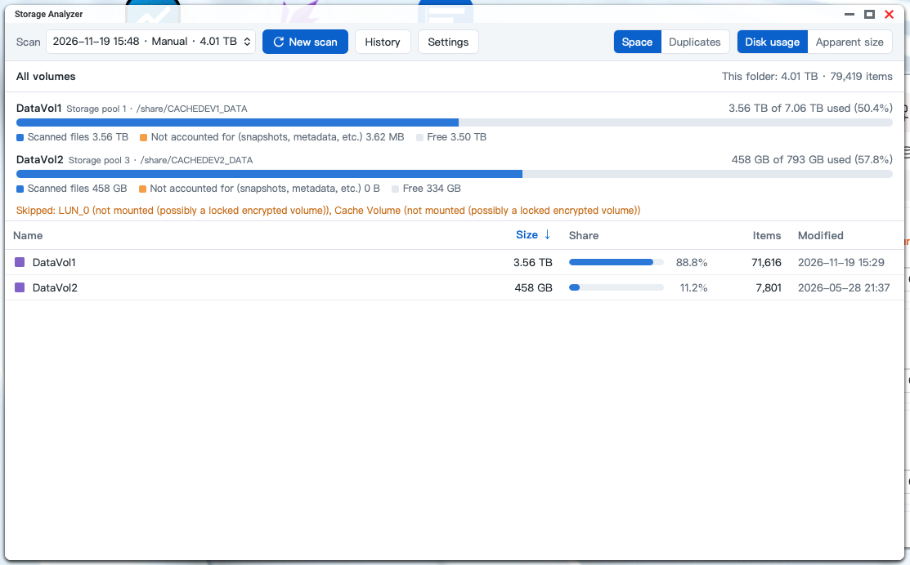
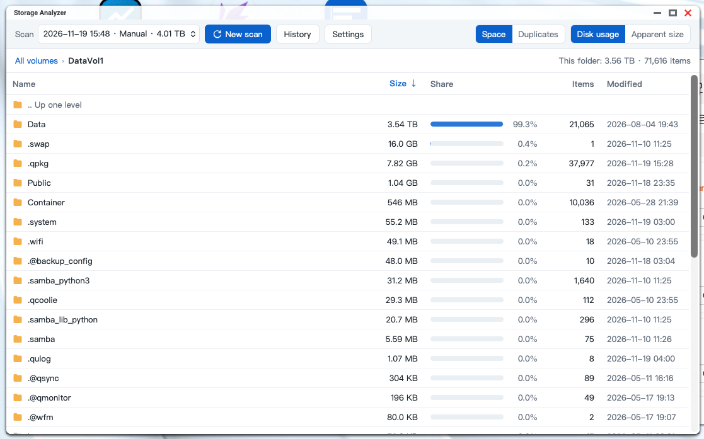

# Storage Analyzer

**English** | [简体中文](README.zh-CN.md)

An ncdu-style disk usage analyzer with a web interface, for Linux servers, QNAP QTS, and fnOS (飞牛). It scans your disks, lets you drill down folder by folder to see what is taking up space, attributes Docker storage usage, finds files and folders with identical content, lets you safely delete unneeded items, and keeps a history of past scans.





## Features

- **Automatic volume discovery.** Discovers local disk filesystems on Linux (or scans a custom path list), all storage-pool data volumes on QNAP QTS, and all storage spaces (`/vol1`, `/vol2`, …) on fnOS.
- **Folder-by-folder drill-down.** Sort by size, name, item count or modified time. Switch between *Disk usage* (space taken on disk) and *Apparent size* (size of the file contents).
- **Accounts for the whole volume.** Each volume's bar shows the scanned files, space that isn't accounted for by any file (snapshots, file system metadata, etc.) and free space.
- **Docker storage attribution.** Detects Docker `overlay2`, `containers`, `volumes` and BuildKit cache directories and labels each entry with its owning images, containers, or volumes (as well as unreferenced directories).
- **Duplicate finder.** Finds files and folders with identical content, verified with a full SHA-256 hash. When two whole folders are identical, only the largest identical folder is listed, not everything inside it.
- **Delete files with safety guardrails.** Delete individual files or folders directly, or stage items across multiple folders and the Duplicates view in a **Delete basket** before removing them together. Volume roots, mount points, critical system paths, app data/config directories and older scan snapshots are protected; Linux and fnOS deployments can also disable deletion for read-only use.
- **Scheduled or on-demand scans.** Run a scan by hand, or daily or weekly at a set time, optionally followed by a duplicate check.
- **Scan history.** Keeps the most recent successful scans (10 by default), so you can open an older scan and browse it in full.
- **Stays out of the way.** Scans, duplicate checks and deletions run at the lowest CPU and I/O priority. The resident services on Linux and fnOS use no CPU while idle; the QNAP version has no background process between tasks.
- **English and Chinese UI**, following the browser language on Linux and fnOS and the QTS language on QNAP.

## Usage

### Scanning

Click **New scan**. Progress is shown at the top of the window, and you can keep browsing older results while it runs. A scan usually takes a few minutes to tens of minutes, depending on how many files you have.

Use the **Scan** picker to switch between saved scans. **History** lists every scan with its time, trigger, status, total size, file count and duration, and lets you open or delete one.

### Browsing

The top level shows each scanned volume or filesystem. Click a folder to open it, and use the breadcrumbs or **.. Up one level** to go back. Click a column header to sort by it.

Hard links are counted only once (the other links are tagged), symbolic links aren't followed, and scans don't cross into other mounted file systems.

### Duplicates

Switch to **Duplicates** and click **Start duplicate check**. Groups of identical files and folders are listed largest first, with how much space removing the extra copies would free up. **↗ Show location** opens the folder in the Space view.

- Folders count as identical when their file names, subfolder structure and file contents all match; the folders' own names may differ.
- Empty files and hard links aren't reported as duplicates. Thumbnail and system files (`@__thumb`, `.@__thumb`, `@eaDir`, `.DS_Store`, `Thumbs.db`, `._*`) are ignored.
- Files that changed after the scan are left out of the comparison.
- Hashes are cached between checks. The first check reads every candidate file and can take a few hours; later checks only read new or changed files and usually take minutes to an hour.

### Deleting files

When viewing the latest completed scan, you can delete individual items directly or check files and folders across different directories and the **Duplicates** view to collect them in the **Delete basket** at the bottom of the window, then review and permanently delete everything in one batch.

- Deletions are permanent (no recycle bin) and run in the background with live progress and a stop button, updating the scan totals and duplicate list automatically once finished.
- In **Duplicates**, the UI prevents staging or deleting the last remaining copy of a group (use the Space view if you intentionally want to remove every copy).
- Historical scans are read-only; volume roots, mount points, critical OS paths, and Storage Analyzer's own data/config directories cannot be deleted; Docker internal directories require an extra risk confirmation.
- Deletion can be disabled completely on Linux (`allow_delete = false` in `/etc/storage-analyzer/config`) and on fnOS (via **App Center → Storage Analyzer → Settings**).

### Settings

- **Scheduled scan:** off, daily or weekly, at a time in the server's local time zone.
- **Check for duplicates after the scan:** runs a duplicate check on each scheduled scan once it finishes.
- **Keep results:** how many recent successful scans to keep (1–100). Each result takes tens to hundreds of MB.
- **Default size:** whether to show *Disk usage* or *Apparent size* by default.

## Supported Platforms

| Platform | Packages | Architectures | Access & Auth | Default Scan Scope |
| --- | --- | --- | --- | --- |
| **[Linux](#linux)** | `.deb`, `.rpm`, `.tar.gz` | `amd64`, `arm64`, `armv7` | Standalone web server (`:8099`) with built-in password sign-in | Local disk filesystems (configurable `paths` / `exclude`) |
| **[QNAP QTS](#qnap-qts)** | `.qpkg` | `x86_64`, `arm_64`, `arm-x41` | QTS desktop window via CGI, QTS administrator session | All mounted storage-pool data volumes |
| **[fnOS (飞牛)](#fnos-飞牛)** | `.fpk` | `x86`, `arm` | fnOS desktop window via Unified Gateway, fnOS administrator session | All storage spaces (`/vol1`, `/vol2`, …), optional `/` & external storage |

### Linux

Runs as a systemd service on `x86_64`, `arm64` and `armv7`.

#### Installation

Download the package for your system from [Releases](https://github.com/FlintyLemming/storage-analyzer/releases/latest). Each release includes these files plus a `SHA256SUMS` file:

- `storage-analyzer_<version>_linux_{amd64,arm64,armv7}.tar.gz`
- `storage-analyzer_<version>_{amd64,arm64,armhf}.deb`
- `storage-analyzer-<version>-1.{x86_64,aarch64,armv7hl}.rpm`

1. Install it. On Debian, Ubuntu and similar:

   ```bash
   sudo apt install ./storage-analyzer_<version>_amd64.deb
   ```

   On Fedora, RHEL and similar:

   ```bash
   sudo dnf install ./storage-analyzer-<version>-1.x86_64.rpm
   ```

   Or extract the `.tar.gz` and run its installer, which installs to `/usr/local/bin` and `/etc/systemd/system`:

   ```bash
   sudo ./install.sh
   ```

   The first install doesn't start the service.

2. Set the password. There is a single password and no username, at least 12 characters, and it can only be set on the server itself:

   ```bash
   sudo storage-analyzer passwd
   ```

   Running it again changes the password and signs out every session.

3. Start the service and enable it at boot:

   ```bash
   sudo systemctl enable --now storage-analyzer
   ```

4. Open `http://SERVER:8099` in a browser and sign in.

The service runs as the dedicated non-root user `storage-analyzer` with systemd sandboxing (`ProtectSystem=full`, keeping `/usr`, `/boot`, `/efi`, `/etc`, and system library/binary directories read-only) and `CAP_DAC_READ_SEARCH`, `CAP_DAC_OVERRIDE`, and `CAP_FOWNER` capabilities so it can scan and delete user data files without running as root. Data is kept in `/var/lib/storage-analyzer`, the configuration is `/etc/storage-analyzer/config`, the password hash is `/etc/storage-analyzer/password`, and logs go to the journal (`journalctl -u storage-analyzer`). Scans, duplicate checks, and deletions run at the lowest CPU and I/O priority as child processes.

#### What gets scanned

By default it discovers local disk filesystems from the mount table (ext2/3/4, xfs, btrfs, zfs, f2fs, bcachefs, jfs, reiserfs, ntfs/ntfs3, exfat, vfat, fuseblk). Network filesystems (NFS, SMB, sshfs and other FUSE), virtual and memory filesystems, bind mounts of a filesystem that is already included, and btrfs `.snapshots` are skipped. On Linux 4.18+, unmounted nested btrfs subvolumes are scanned as part of their parent volume, while btrfs snapshots and subvolumes separately mounted elsewhere are still skipped. Set `paths` to scan exactly the directories you list instead; network filesystems are allowed when you list them. In automatic mode, `exclude` drops whole mount points. The shipped config excludes common container and Kubernetes runtime mounts (`/var/lib/containerd`, `/var/lib/docker`, `/var/lib/containers`, `/var/lib/etcd`, `/var/lib/kubelet`); edit or comment out `exclude` to scan them.

#### Configuration

Edit `/etc/storage-analyzer/config`, then restart the service with `sudo systemctl restart storage-analyzer`. The format is `key = value`, one per line. Only whole-line `#` comments are allowed (no comments after a value), and unknown keys are errors. The file shipped in the package comes with default settings and commented examples.

| Key | Default | Meaning |
| --- | --- | --- |
| `listen` | `:8099` | Address and port to listen on |
| `tls_cert`, `tls_key` | not set | Paths to a PEM certificate and key. Set both or neither. A renewed certificate is picked up without a restart. |
| `trusted_proxies` | not set | Comma-separated IPs or CIDRs of reverse proxies whose `X-Forwarded-For` and `X-Forwarded-Proto` headers are trusted |
| `data_dir` | `/var/lib/storage-analyzer` | Where scan results and state are stored |
| `paths` | `auto` | `auto`, or a comma-separated list of directories, such as `/a, /b` |
| `exclude` | not set (shipped config sets `/var/lib/containerd, /var/lib/docker, /var/lib/containers, /var/lib/etcd, /var/lib/kubelet`) | Comma-separated mount points to leave out in auto mode; remove or comment out the line to exclude nothing |
| `allow_delete` | `true` | Allow deleting files and folders from the web UI (`true` or `false`). Set `false` for read-only deployments. |

#### HTTPS and reverse proxy

Without HTTPS, the sign-in page warns that the connection isn't encrypted. Either serve HTTPS directly by setting `tls_cert` and `tls_key`, or put the service behind a reverse proxy.

When using a proxy, listen on loopback only and add the proxy's address to `trusted_proxies`, so the real client address is used. Otherwise every user appears as the proxy's address and they all share one sign-in lockout.

```ini
listen = 127.0.0.1:8099
trusted_proxies = 127.0.0.1
```

Caddy:

```caddy
storage.example.com {
    reverse_proxy 127.0.0.1:8099
}
```

nginx:

```nginx
location / {
    proxy_pass http://127.0.0.1:8099;
    proxy_set_header Host $host;
    proxy_set_header X-Forwarded-For $proxy_add_x_forwarded_for;
    proxy_set_header X-Forwarded-Proto $scheme;
}
```

#### Sign-in protection

After 5 failed sign-in attempts from one address within 15 minutes, that address is locked out for 15 minutes. Across all addresses, at most 20 password checks are made per minute. Failed attempts are logged as `login failed from <ip>`, which fail2ban can match. A session cookie lasts 30 days.

#### Ports below 1024, custom data directory, and stricter sandboxing

The service can't bind ports below 1024 by default. To use one, move `data_dir`, or further restrict write access at the kernel level, add a systemd override:

```bash
sudo systemctl edit storage-analyzer
```

For a port below 1024:

```ini
[Service]
AmbientCapabilities=CAP_DAC_READ_SEARCH CAP_DAC_OVERRIDE CAP_FOWNER CAP_NET_BIND_SERVICE
CapabilityBoundingSet=CAP_DAC_READ_SEARCH CAP_DAC_OVERRIDE CAP_FOWNER CAP_NET_BIND_SERVICE
```

For a different `data_dir`, make the directory writable by the `storage-analyzer` user (and add `ReadWritePaths=/your/data/dir` if you also set `ProtectSystem=strict`).

To lock Linux down to strict read-only mode at the kernel level (in addition to `allow_delete = false`), or to restrict deletions to specific data directories only:

```ini
[Service]
ProtectSystem=strict
# Omit ReadWritePaths for strict read-only, or list only directories allowed for deletion:
# ReadWritePaths=/mnt/data /srv/media
# For strict read-only you can also drop write capabilities:
# AmbientCapabilities=CAP_DAC_READ_SEARCH
# CapabilityBoundingSet=CAP_DAC_READ_SEARCH
```

Then restart the service.

#### Uninstalling

- Debian and Ubuntu: `sudo apt remove storage-analyzer` keeps the configuration and data; `sudo apt purge storage-analyzer` removes them too.
- Fedora and RHEL: `sudo dnf remove storage-analyzer` keeps the data. Delete `/etc/storage-analyzer` and `/var/lib/storage-analyzer` by hand if you want them gone.
- Tarball install: `sudo ./uninstall.sh`. Add `--purge` to also delete the configuration and data.

#### Known limitations

- There is no Docker image yet.
- The packages only support systemd; other init systems aren't supported.

### QNAP QTS

#### Requirements

- QTS 5.0 or later
- One of these architectures:
  - `x86_64`: Intel and AMD models
  - `arm_64`: 64-bit ARM models
  - `arm-x41`: 32-bit ARM models with an Annapurna Labs Alpine CPU, such as TS-x31P, TS-x31X and TS-x31K
- A QTS administrator account. The app shows the names of every user's files, so only administrators can open it.

> [!NOTE]
> The ARM packages are built and tested under emulation but haven't been tried on a real ARM NAS yet. If you run one, feedback is welcome.

#### Installation

1. Download the `.qpkg` for your NAS's architecture from [Releases](https://github.com/FlintyLemming/storage-analyzer/releases/latest).
2. The package isn't signed by QNAP, so allow unsigned apps first: in **App Center**, open **Settings** (gear icon) → **General** and turn on **Allow installation of applications without a valid digital signature**.
3. In App Center, click **Install Manually** (the icon next to the gear), choose the downloaded file and confirm.
4. Open **Storage Analyzer** from the QTS main menu.

To update, install the newer `.qpkg` the same way. Your scan history and settings are kept. All data lives in the app's install folder and is removed when the app is uninstalled.

### fnOS (飞牛)

#### Requirements

- fnOS `1.1.3100` or later (required for Unified Gateway)
- One of these architectures:
  - `x86`: x86_64 Intel and AMD devices
  - `arm`: 64-bit ARM devices
- A fnOS administrator account. The app shows every user's file names and is restricted to administrators via the fnOS Unified Gateway.

> [!NOTE]
> The `x86` package has been tested on a real x86_64 fnOS device; the `arm` package passes the test suite under emulation and hasn't been tried on real ARM hardware yet.

#### Installation

1. Download `storage-analyzer_<version>_fnos_<arch>.fpk` for your device from [Releases](https://github.com/FlintyLemming/storage-analyzer/releases/latest).
2. In **App Center**, click **Manual Install** (手动安装), choose the `.fpk` file, pick the storage volume to install to, and confirm. Or install over SSH:

   ```bash
   sudo appcenter-cli install-fpk storage-analyzer_<version>_fnos_x86.fpk
   ```

3. Open **Storage Analyzer** from the fnOS desktop or App Center.

No extra port or separate password is needed: it registers on the fnOS Unified Gateway (`/app/storage-analyzer/`) over a local Unix socket (`app.sock`), reusing your fnOS administrator session and working over HTTP, HTTPS, and fnConnect.

#### Configuration and updates

By default only fnOS storage spaces (`/vol1`, `/vol2`, …) are scanned, skipping `/`, `/boot/efi`, virtual filesystems and remote mounts. To also scan the system partition `/` or external storage, or to disable web file deletion for read-only mode, open **App Center → Storage Analyzer → Settings**; saving automatically restarts the service.

Scan databases and logs live in the app's `@appdata` directory (`TRIM_PKGVAR`). To update, install the newer `.fpk`; scan history and settings are preserved.

## Building from source

You need Go 1.26 or later. Docker is required for Linux `.deb`/`.rpm` packaging (`nfpm`), QNAP packaging ([QDK](https://github.com/qnap-dev/QDK)), and multi-architecture Linux tests.

```bash
# Linux packages: build/linux/storage-analyzer_<version>_{tar.gz,deb,rpm}
./scripts/build-linux.sh

# QNAP packages: build/StorageAnalyzer_<version>_{x86_64,arm_64,arm-x41}.qpkg
./scripts/build.sh

# fnOS packages: build/fnos/storage-analyzer_<version>_fnos_{x86,arm}.fpk
# (uses fnpack from PATH or downloads it automatically; builds unsigned with --nosign by default)
./scripts/build-fnos.sh
```

To work on the UI locally, build a native binary, write a dev config file pointing at the folder you want to scan, and start the development server (it skips authentication and only listens on loopback):

```bash
mkdir -p build/dev
printf 'data_dir = %s/build/dev/data\npaths = %s/Projects\n' "$PWD" "$HOME" > build/dev/config
go build -o build/dev/bin/storage-analyzer ./cmd/storage-analyzer
./build/dev/bin/storage-analyzer serve --config build/dev/config --insecure-no-auth --web web
```

Then open <http://127.0.0.1:8099/>.

## How it works

A single static Go binary serves everything, compiled per platform with Go build tags so each package only includes the code it needs. Each scan is saved as its own SQLite database, so opening an old scan is as fast as opening the latest.

- **Linux:** Runs as a resident systemd service with embedded frontend assets, built-in password authentication, an in-process scheduler, and child processes for scans, duplicate checks, and deletions.
- **QNAP QTS:** Has no resident process. Runs as a CGI program behind QTS's web server using the QTS administrator session, launches background processes on demand, and registers scheduled scans in the QTS crontab.
- **fnOS:** Runs as a resident service listening only on the Unified Gateway Unix socket (`app.sock`), reusing the fnOS administrator session, with embedded frontend assets, an in-process scheduler, and child processes for scans, duplicate checks, and deletions.

## License

MIT
