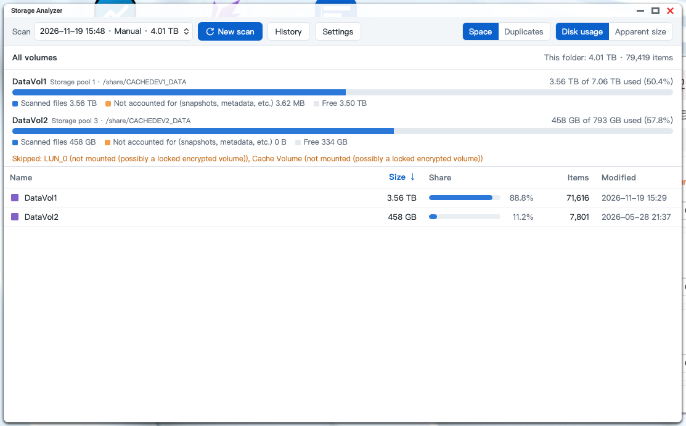

# Storage Analyzer

[English](README.md) | **简体中文**

带网页界面的"图形版 ncdu"，支持普通 Linux 服务器、QNAP QTS 与飞牛 fnOS。它可以扫描磁盘、按目录逐层下钻找出空间占用来源、解析 Docker 存储归属、查找内容完全相同的文件和文件夹、安全清理不需要的文件，并保存历史扫描结果。




## 功能

- **自动发现数据卷**：在 Linux 上自动识别本地磁盘文件系统（也可自定义扫描目录）；在 QNAP 上自动识别所有存储池上的数据卷；在飞牛 fnOS 上默认自动扫描所有存储空间（`/vol1`、`/vol2` 等）。
- **逐层下钻**：按大小、名称、项数或修改时间排序；可在"磁盘占用"（实际占用的磁盘空间）和"表观大小"（文件内容本身的大小）之间切换。
- **看清整个卷**：每个卷的容量条分为扫描到的文件、未计入任何文件的已用空间（快照、文件系统元数据等）和可用空间。
- **Docker 空间占用解析**：自动识别 Docker 的 `overlay2`、`containers`、`volumes` 和 BuildKit 缓存目录，标注每个目录对应的镜像、容器或数据卷归属，以及未被任何对象引用的目录。
- **查找重复项**：找出内容完全相同的文件和文件夹，全部经过完整的 SHA-256 校验。两个文件夹整体相同时，只列出最大的那一层相同文件夹，不再逐个列出里面的内容。
- **带安全护栏的文件删除**：支持单条直接永久删除，也支持在空间占用视图和重复项视图中跨目录勾选，先加入底部的**待删收集箱**统一核对后再批量删除；内置卷根、挂载点、系统关键目录、应用自身目录与历史快照保护，Linux 版和飞牛 fnOS 版均可关闭删除功能以切换为只读模式。
- **定时或手动扫描**：随时手动扫描，也可以每天或每周定时扫描，并可在扫描完成后自动检查重复项。
- **扫描历史**：保留最近几次成功的扫描结果（默认 10 次），旧结果同样可以完整浏览。
- **不打扰系统**：扫描、重复检查和删除均以最低的 CPU 和 I/O 优先级运行。Linux 版与飞牛 fnOS 版空闲时不占 CPU，QNAP 版在两次任务之间没有任何后台进程。
- **中英文界面**：Linux 版与飞牛 fnOS 版跟随浏览器语言，QNAP 版跟随 QTS 的语言设置。

## 使用

### 扫描

点 **新建扫描**。窗口顶部会显示进度，扫描期间仍可浏览之前的结果。根据文件数量，一次扫描通常需要几分钟到几十分钟。

用 **扫描结果** 下拉框在已保存的扫描之间切换。**历史** 列出每次扫描的时间、方式、状态、总占用、文件数和耗时，可以打开或删除。

### 浏览

顶层列出各个被扫描的卷或文件系统。点文件夹进入，点面包屑路径或 **.. 上一级** 返回；点列标题按该列排序。

硬链接只计一次（其余链接会被标注），不跟随符号链接，也不会跨进其他挂载的文件系统。

### 重复项

切换到 **重复项**，点 **开始重复检查**。相同的文件和文件夹按组列出，从大到小排列，并显示删掉多余副本后可释放的空间。**↗ 查看位置** 会在空间占用视图中打开所在目录。

- 文件夹相同，指里面的文件名、子文件夹结构和每个文件的内容都一致；文件夹本身的名字可以不同。
- 空文件和硬链接不算重复。缩略图和系统文件（`@__thumb`、`.@__thumb`、`@eaDir`、`.DS_Store`、`Thumbs.db`、`._*`）会被忽略。
- 扫描后发生变化的文件不参与比较。
- 校验值会缓存下来。第一次检查要读所有候选文件，可能需要几个小时；之后只读新增或变化过的文件，通常几分钟到几十分钟。

### 删除文件

查看**最新一次**已完成的扫描结果时，可以直接单条删除，也可以在空间占用视图的不同目录或**重复项**视图中勾选多个文件/文件夹加入底部的**待删收集箱**，统一核对路径和大小后一次性永久删除。

- 删除为直接永久删除（不进回收站），在后台执行并显示实时进度，可随时停止；完成后自动更新当前扫描的空间统计和重复项列表。
- 在**重复项**视图中会自动阻止把同一组的最后 1 份副本也勾选或删除（如确需全删请前往空间占用视图）。
- 历史扫描结果保持只读；卷根目录、挂载点、关键系统目录以及应用自身的数据/配置目录禁止删除；删除 Docker 内部目录需要额外勾选风险确认。
- Linux 版可在 `/etc/storage-analyzer/config` 中设置 `allow_delete = false` 关闭删除功能；飞牛 fnOS 版可在 **应用中心 → Storage Analyzer → 应用设置** 中关闭。

### 设置

- **定时扫描**：关闭、每天或每周，时间按服务器本地时区。
- **扫描完成后检查重复项**：每次定时扫描完成后，接着对这次结果做重复检查。
- **保留结果**：保留最近几次成功的扫描结果（1–100），每份结果约占几十到几百 MB。
- **默认显示**：默认显示"磁盘占用"还是"表观大小"。

## 平台与安装

| 平台 | 安装包 | 支持架构 | 访问与鉴权 | 默认扫描范围 |
| --- | --- | --- | --- | --- |
| **[Linux](#linux)** | `.deb`、`.rpm`、`.tar.gz` | `amd64`、`arm64`、`armv7` | 独立 Web 服务（默认 `:8099`），内置密码登录 | 本地磁盘文件系统（支持 `paths` / `exclude`） |
| **[QNAP QTS](#qnap-qts)** | `.qpkg` | `x86_64`、`arm_64`、`arm-x41` | QTS 桌面窗口（CGI），复用 QTS 管理员登录态 | 所有已挂载存储池的数据卷 |
| **[飞牛 fnOS](#飞牛-fnos)** | `.fpk` | `x86`、`arm` | 飞牛桌面窗口（统一网关），复用飞牛管理员登录态 | 所有存储空间（`/vol1`、`/vol2` 等），可选 `/` 与外接存储 |

### Linux

以 systemd 服务方式运行，支持 `x86_64`、`arm64` 和 `armv7`。

#### 安装

从 [Releases](https://github.com/FlintyLemming/storage-analyzer/releases/latest) 下载适合你系统的安装包。每个版本包含以下文件，以及一个 `SHA256SUMS` 校验文件：

- `storage-analyzer_<版本>_linux_{amd64,arm64,armv7}.tar.gz`
- `storage-analyzer_<版本>_{amd64,arm64,armhf}.deb`
- `storage-analyzer-<版本>-1.{x86_64,aarch64,armv7hl}.rpm`

1. 安装。Debian、Ubuntu 等：

   ```bash
   sudo apt install ./storage-analyzer_<版本>_amd64.deb
   ```

   Fedora、RHEL 等：

   ```bash
   sudo dnf install ./storage-analyzer-<版本>-1.x86_64.rpm
   ```

   或者解压 `.tar.gz`，运行里面的安装脚本，它会安装到 `/usr/local/bin` 和 `/etc/systemd/system`：

   ```bash
   sudo ./install.sh
   ```

   首次安装不会启动服务。

2. 设置密码。只有一个密码，没有用户名，至少 12 个字符，并且只能在服务器本机设置：

   ```bash
   sudo storage-analyzer passwd
   ```

   再次运行会修改密码，并让所有已登录的会话失效。

3. 启动服务并设为开机自启：

   ```bash
   sudo systemctl enable --now storage-analyzer
   ```

4. 用浏览器打开 `http://服务器:8099` 并登录。

服务以非 root 专用用户 `storage-analyzer` 运行，配合 systemd 沙盒（`ProtectSystem=full`，内核层面保持 `/usr`、`/boot`、`/efi`、`/etc` 及系统二进制/库目录只读）和 `CAP_DAC_READ_SEARCH`、`CAP_DAC_OVERRIDE`、`CAP_FOWNER` 能力，从而在不以 root 运行的前提下完成扫描与删除用户数据文件。数据保存在 `/var/lib/storage-analyzer`，配置文件是 `/etc/storage-analyzer/config`，密码哈希在 `/etc/storage-analyzer/password`，日志在 journal 中（`journalctl -u storage-analyzer`）。扫描、重复检查与删除均以最低 CPU 和 I/O 优先级作为子进程运行。

#### 扫描范围

默认根据挂载表自动识别本地磁盘文件系统（ext2/3/4、xfs、btrfs、zfs、f2fs、bcachefs、jfs、reiserfs、ntfs/ntfs3、exfat、vfat、fuseblk）。网络文件系统（NFS、SMB、sshfs 及其他 FUSE）、虚拟和内存文件系统、对已包含文件系统的 bind 挂载，以及 btrfs 的 `.snapshots` 都会跳过。在 Linux 4.18 及以上内核上，未单独挂载的嵌套 btrfs 子卷会随所属卷一起扫描，btrfs 快照以及已在别处单独挂载的子卷仍会跳过。设置 `paths` 则只扫描你列出的目录，列出的网络文件系统也会被扫描。自动模式下，`exclude` 可以排除整个挂载点。安装包自带的默认配置已排除常见容器与 Kubernetes 运行时挂载点（`/var/lib/containerd`、`/var/lib/docker`、`/var/lib/containers`、`/var/lib/etcd`、`/var/lib/kubelet`）；如需扫描，修改或注释掉 `exclude` 即可。

#### 配置

编辑 `/etc/storage-analyzer/config`，然后用 `sudo systemctl restart storage-analyzer` 重启服务。格式为每行一个 `key = value`；只支持整行的 `#` 注释（值后面不能跟注释），出现未知的键会报错。安装包里附带的文件包含默认配置和带注释的示例。

| 配置项 | 默认值 | 说明 |
| --- | --- | --- |
| `listen` | `:8099` | 监听的地址和端口 |
| `tls_cert`、`tls_key` | 未设置 | PEM 格式的证书和私钥路径，必须同时设置或同时不设置。证书续期后无需重启即可生效。 |
| `trusted_proxies` | 未设置 | 以逗号分隔的反向代理 IP 或 CIDR，信任它们发来的 `X-Forwarded-For` 和 `X-Forwarded-Proto` |
| `data_dir` | `/var/lib/storage-analyzer` | 扫描结果和状态的保存位置 |
| `paths` | `auto` | `auto`，或以逗号分隔的目录列表，如 `/a, /b` |
| `exclude` | 未设置（安装包默认配置为 `/var/lib/containerd, /var/lib/docker, /var/lib/containers, /var/lib/etcd, /var/lib/kubelet`） | 自动模式下要排除的挂载点，以逗号分隔；删除或注释掉该行即不排除 |
| `allow_delete` | `true` | 是否允许在网页界面删除文件/目录（`true` 或 `false`）；设为 `false` 即切换为纯只读模式 |

#### HTTPS 与反向代理

不使用 HTTPS 时，登录页会提示连接未加密。要么设置 `tls_cert` 和 `tls_key` 直接提供 HTTPS，要么把服务放在反向代理后面。

放在代理后面时，只监听本机回环地址，并把代理的地址加入 `trusted_proxies`，这样才能拿到真实的客户端地址。否则所有用户看起来都来自代理的地址，会共用同一个登录锁定额度。

```ini
listen = 127.0.0.1:8099
trusted_proxies = 127.0.0.1
```

Caddy：

```caddy
storage.example.com {
    reverse_proxy 127.0.0.1:8099
}
```

nginx：

```nginx
location / {
    proxy_pass http://127.0.0.1:8099;
    proxy_set_header Host $host;
    proxy_set_header X-Forwarded-For $proxy_add_x_forwarded_for;
    proxy_set_header X-Forwarded-Proto $scheme;
}
```

#### 登录保护

同一地址 15 分钟内登录失败 5 次，该地址会被锁定 15 分钟。所有地址合计每分钟最多检查 20 次密码。失败的尝试会记录为 `login failed from <ip>`，可以配合 fail2ban 使用。登录状态（Cookie）有效期 30 天。

#### 1024 以下的端口、自定义数据目录与更严格的沙盒

服务默认不能绑定 1024 以下的端口。要使用这类端口、调整 `data_dir`，或者在内核层面进一步收紧写权限，可以添加 systemd override：

```bash
sudo systemctl edit storage-analyzer
```

使用 1024 以下的端口：

```ini
[Service]
AmbientCapabilities=CAP_DAC_READ_SEARCH CAP_DAC_OVERRIDE CAP_FOWNER CAP_NET_BIND_SERVICE
CapabilityBoundingSet=CAP_DAC_READ_SEARCH CAP_DAC_OVERRIDE CAP_FOWNER CAP_NET_BIND_SERVICE
```

使用其他 `data_dir`：先让 `storage-analyzer` 用户对该目录有写权限（如果同时启用了 `ProtectSystem=strict`，还需要加上 `ReadWritePaths=/your/data/dir`）。

若希望在内核层强制纯只读（配合配置里的 `allow_delete = false`），或只允许删除特定数据目录下的文件：

```ini
[Service]
ProtectSystem=strict
# 纯只读时省略 ReadWritePaths；若只想放行特定目录则列在这里：
# ReadWritePaths=/mnt/data /srv/media
# 纯只读模式还可以去掉写权限能力：
# AmbientCapabilities=CAP_DAC_READ_SEARCH
# CapabilityBoundingSet=CAP_DAC_READ_SEARCH
```

然后重启服务。

#### 卸载

- Debian、Ubuntu：`sudo apt remove storage-analyzer` 会保留配置和数据；`sudo apt purge storage-analyzer` 会一并删除。
- Fedora、RHEL：`sudo dnf remove storage-analyzer` 会保留数据。如需彻底清除，请手动删除 `/etc/storage-analyzer` 和 `/var/lib/storage-analyzer`。
- tar.gz 安装：运行 `sudo ./uninstall.sh`。加上 `--purge` 会一并删除配置和数据。

#### 已知限制

- 暂时没有 Docker 镜像。
- 安装包只支持 systemd，不支持其他 init 系统。

### QNAP QTS

#### 系统要求

- QTS 5.0 或更高版本
- 以下架构之一：
  - `x86_64`：Intel 和 AMD 机型
  - `arm_64`：64 位 ARM 机型
  - `arm-x41`：Annapurna Labs Alpine 处理器的 32 位 ARM 机型，如 TS-x31P、TS-x31X、TS-x31K
- QTS 管理员账号。应用能看到所有用户的文件名，因此只有管理员可以打开。

> [!NOTE]
> ARM 安装包已在模拟环境中编译并通过测试，但还没有在真实的 ARM NAS 上试过。如果你在 ARM 机型上使用，欢迎反馈。

#### 安装

1. 从 [Releases](https://github.com/FlintyLemming/storage-analyzer/releases/latest) 下载与 NAS 架构对应的 `.qpkg` 文件。
2. 安装包没有 QNAP 的数字签名，需要先允许安装未签名的应用：打开 **App Center**，点 **设置**（齿轮图标）→ **常规**，勾选 **允许安装没有有效数字签名的应用程序**。
3. 在 App Center 中点 **手动安装**（齿轮旁边的图标），选择下载的文件并确认。
4. 从 QTS 主菜单打开 **Storage Analyzer**。

升级时按同样的方式安装新版本的 `.qpkg`，扫描历史和设置都会保留。所有数据都保存在应用的安装目录中，卸载应用时一并删除。

### 飞牛 fnOS

#### 系统要求

- 飞牛 fnOS `1.1.3100` 或更高版本（统一网关所需）
- 以下架构之一：
  - `x86`：x86_64 机型
  - `arm`：64 位 ARM 机型
- 飞牛管理员账号。应用能看到所有用户的文件名，因此通过统一网关和桌面入口权限仅限管理员使用。

> [!NOTE]
> `x86` 安装包已在真实 x86_64 飞牛设备上实测；`arm` 安装包在模拟环境中通过测试，尚未在真实 ARM 设备上验证。

#### 安装

1. 从 [Releases](https://github.com/FlintyLemming/storage-analyzer/releases/latest) 下载对应架构的 `storage-analyzer_<版本>_fnos_<架构>.fpk`。
2. 在 **应用中心** 点击右上角 **手动安装**，选择 `.fpk` 文件并选择安装存储空间即可。也可以通过 SSH 命令行安装：

   ```bash
   sudo appcenter-cli install-fpk storage-analyzer_<版本>_fnos_x86.fpk
   ```

3. 从飞牛桌面或应用中心打开 **Storage Analyzer**。

应用通过飞牛**统一网关**（`/app/storage-analyzer/` → 本地 Unix Socket `app.sock`）提供服务，无需开放额外端口，也无需单独设置密码，直接复用飞牛管理员登录态，兼容 HTTP、HTTPS 与 FN Connect 远程访问。

#### 配置与升级

默认仅扫描飞牛存储空间（`/vol1`、`/vol2` 等），自动跳过系统盘 `/`、`/boot/efi`、虚拟文件系统与远程挂载。如需额外扫描系统盘（`/`）、外接存储，或关闭网页删除功能（只读模式），可在 **应用中心 → Storage Analyzer → 应用设置** 中调整，保存后会自动重启生效。

扫描结果与日志保存在应用对应的 `@appdata` 目录（`TRIM_PKGVAR`），覆盖安装新版本 `.fpk` 升级时会保留历史记录与配置。

## 从源码构建

需要 Go 1.26 或更高版本。打包 Linux `.deb`/`.rpm`（`nfpm`）、QNAP `.qpkg`（[QDK](https://github.com/qnap-dev/QDK)）以及运行多架构 Linux 测试需要 Docker。

```bash
# Linux 安装包：build/linux/storage-analyzer_<版本>_{tar.gz,deb,rpm}
./scripts/build-linux.sh

# QNAP 安装包：build/StorageAnalyzer_<版本>_{x86_64,arm_64,arm-x41}.qpkg
./scripts/build.sh

# 飞牛 fnOS 安装包：build/fnos/storage-analyzer_<版本>_fnos_{x86,arm}.fpk
# （自动使用 PATH 中的 fnpack 或按需下载；默认 --nosign 未签名打包）
./scripts/build-fnos.sh
```

在本地开发界面时，先编译本机二进制，写一份指向待扫描目录的开发配置，再启动开发服务器（跳过登录验证，只监听本机回环地址）：

```bash
mkdir -p build/dev
printf 'data_dir = %s/build/dev/data\npaths = %s/Projects\n' "$PWD" "$HOME" > build/dev/config
go build -o build/dev/bin/storage-analyzer ./cmd/storage-analyzer
./build/dev/bin/storage-analyzer serve --config build/dev/config --insecure-no-auth --web web
```

然后打开 <http://127.0.0.1:8099/>。

## 工作原理

整个应用是一个静态编译的 Go 程序，按平台通过 Go build tag 分别编译，每个安装包只包含对应平台所需的代码。每次扫描单独保存为一个 SQLite 数据库，所以打开旧结果和打开最新结果一样快。

- **Linux**：常驻 systemd 服务，前端静态文件内嵌在二进制中，使用内置密码登录、进程内定时调度，并以子进程执行扫描、重复检查和删除。
- **QNAP QTS**：无常驻进程，作为 CGI 程序运行在 QTS Web 服务器后，复用 QTS 管理员登录态，按需拉起后台任务，定时扫描写入 QTS crontab。
- **飞牛 fnOS**：常驻服务，仅监听统一网关的本地 Unix Socket（`app.sock`），复用飞牛管理员登录态，前端内嵌、进程内定时调度，并以子进程执行扫描、重复检查和删除。

## 许可证

MIT
