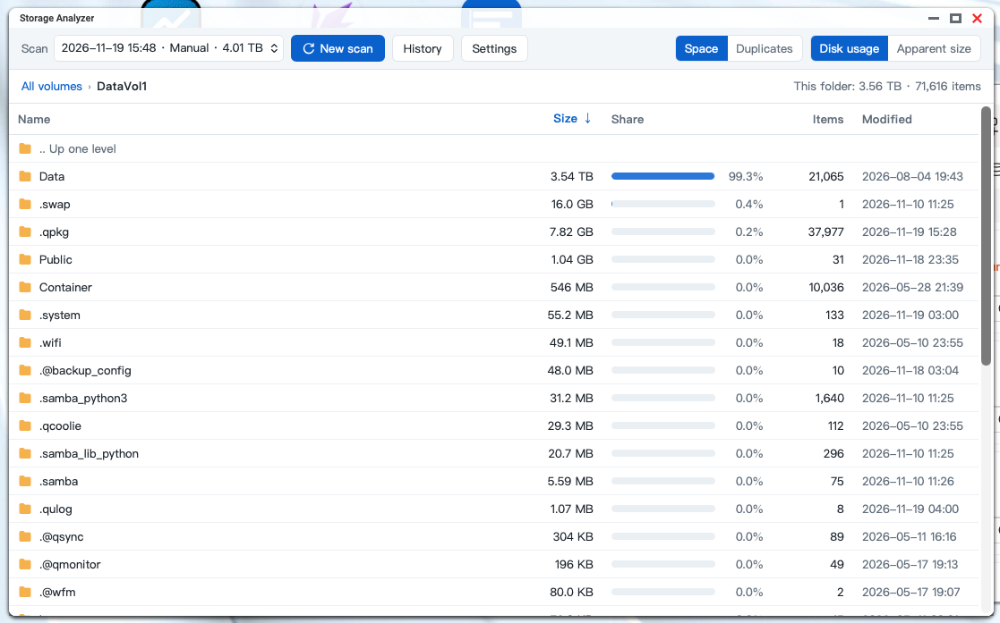

# Storage Analyzer（QNAP 存储分析器）

[English](README.md) | **简体中文**

QNAP QTS 上的"图形版 ncdu"。扫描所有存储池上的数据卷，按目录逐层下钻，找出空间被谁占用；还能找出内容完全相同的文件和文件夹，并保存历史扫描结果。它和资源监视器等内置程序一样，在 QTS 桌面里以窗口方式打开。




## 功能

- **扫描所有数据卷**：自动识别所有存储池上的卷；跳过系统分区，以及未挂载的卷（例如未解锁的加密卷）。
- **逐层下钻**：按大小、名称、项数或修改时间排序；可在"磁盘占用"（实际占用的磁盘空间）和"表观大小"（文件内容本身的大小）之间切换。
- **看清整个卷**：每个卷的容量条分为扫描到的文件、未计入任何文件的已用空间（快照、文件系统元数据等）和可用空间。
- **查找重复项**：找出内容完全相同的文件和文件夹，全部经过完整的 SHA-256 校验。两个文件夹整体相同时，只列出最大的那一层相同文件夹，不再逐个列出里面的内容。
- **定时或手动扫描**：随时手动扫描，也可以每天或每周定时扫描，并可在扫描完成后自动检查重复项。
- **扫描历史**：保留最近几次成功的扫描结果（默认 10 次），旧结果同样可以完整浏览。
- **不打扰 NAS**：扫描和重复检查以最低的 CPU 和 I/O 优先级运行；两次任务之间没有任何后台进程。
- **只读**：不会修改、移动或删除你的任何文件。
- **中英文界面**，跟随 QTS 的语言设置。

## 系统要求

- QTS 5.0 或更高版本
- 以下架构之一：
  - `x86_64`：Intel 和 AMD 机型
  - `arm_64`：64 位 ARM 机型
  - `arm-x41`：Annapurna Labs Alpine 处理器的 32 位 ARM 机型，如 TS-x31P、TS-x31X、TS-x31K
- QTS 管理员账号。应用能看到所有用户的文件名，因此只有管理员可以打开。

> [!NOTE]
> ARM 安装包已在模拟环境中编译并通过测试，但还没有在真实的 ARM NAS 上试过。如果你在 ARM 机型上使用，欢迎反馈。

## 安装

1. 从 [Releases](https://github.com/FlintyLemming/storage-analyzer-qnap/releases/latest) 下载与 NAS 架构对应的 `.qpkg` 文件。
2. 安装包没有 QNAP 的数字签名，需要先允许安装未签名的应用：打开 **App Center**，点 **设置**（齿轮图标）→ **常规**，勾选 **允许安装没有有效数字签名的应用程序**。
3. 在 App Center 中点 **手动安装**（齿轮旁边的图标），选择下载的文件并确认。
4. 从 QTS 主菜单打开 **Storage Analyzer**。

升级时按同样的方式安装新版本的 `.qpkg`，扫描历史和设置都会保留。

## 使用

### 扫描

点 **新建扫描**。窗口顶部会显示进度，扫描期间仍可浏览之前的结果。根据文件数量，一次扫描通常需要几分钟到几十分钟。

用 **扫描结果** 下拉框在已保存的扫描之间切换。**历史** 列出每次扫描的时间、方式、状态、总占用、文件数和耗时，可以打开或删除。

### 浏览

顶层列出各个数据卷。点文件夹进入，点面包屑路径或 **.. 上一级** 返回；点列标题按该列排序。

硬链接只计一次（其余链接会被标注），不跟随符号链接，也不会跨进其他挂载的文件系统。

### 重复项

切换到 **重复项**，点 **开始重复检查**。相同的文件和文件夹按组列出，从大到小排列，并显示删掉多余副本后可释放的空间。**↗ 查看位置** 会在空间占用视图中打开所在目录。

- 文件夹相同，指里面的文件名、子文件夹结构和每个文件的内容都一致；文件夹本身的名字可以不同。
- 空文件和硬链接不算重复。缩略图和系统文件（`@__thumb`、`.@__thumb`、`@eaDir`、`.DS_Store`、`Thumbs.db`、`._*`）会被忽略。
- 扫描后发生变化的文件不参与比较。
- 校验值会缓存下来。第一次检查要读所有候选文件，可能需要几个小时；之后只读新增或变化过的文件，通常几分钟到几十分钟。

Storage Analyzer 不会删除任何东西，不需要的文件请用 File Station 等工具自行删除。

### 设置

- **定时扫描**：关闭、每天或每周，时间按 NAS 本地时区。
- **扫描完成后检查重复项**：每次定时扫描完成后，接着对这次结果做重复检查。
- **保留结果**：保留最近几次成功的扫描结果（1–100），每份结果约占几十到几百 MB。
- **默认显示**：默认显示"磁盘占用"还是"表观大小"。

## 从源码构建

需要 Go 1.26 或更高版本，以及 Docker。打包使用 QNAP 的 [QDK](https://github.com/qnap-dev/QDK)，在容器中运行。

```bash
./scripts/build.sh
```

它会先运行测试（包括在 Docker 中针对每个架构运行的 Linux 测试），然后交叉编译，生成 `x86_64`、`arm_64` 和 `arm-x41` 三个安装包：`build/StorageAnalyzer_<版本>_<架构>.qpkg`。

在本地开发界面时，先编译本机二进制，再启动开发服务器。它扫描 `SA_DEV_ROOTS` 中列出的目录而不是 NAS 的卷，并且跳过登录验证，因此只监听本机回环地址：

```bash
go build -o build/dev/bin/storage-analyzer ./cmd/storage-analyzer
```

```bash
SA_DEV_ROOTS=$HOME/Projects ./build/dev/bin/storage-analyzer serve --insecure-no-auth --root build/dev --web web
```

然后打开 <http://127.0.0.1:8099/>。

## 工作原理

没有常驻进程。一个静态编译的 Go 程序既作为 CGI 程序、通过 QTS 自带的 Web 服务器为界面提供接口，也在开始扫描或重复检查时被拉起到后台执行任务。定时扫描是 QTS crontab 中的一行。每次扫描单独保存为一个 SQLite 数据库，所以打开旧结果和打开最新结果一样快。所有数据都保存在应用的安装目录中，卸载应用时一并删除。

## 许可证

MIT
